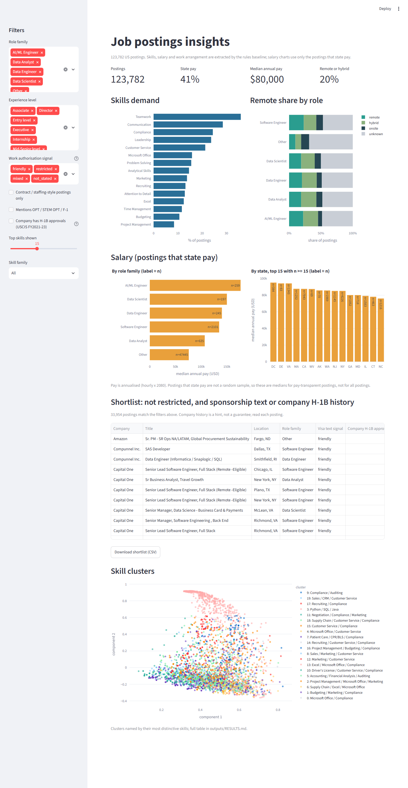

# Job Postings Insights

A small NLP / analytics pipeline over US job postings. It extracts **skills, salary, work arrangement
(remote / hybrid / onsite)** and **work-authorisation signals for F-1 OPT / STEM OPT candidates**
(sponsorship offered, no sponsorship, OPT welcomed, contract / staffing-style postings), scores each method
against labelled examples, clusters postings by skills, models salary, and serves a dashboard.



## What it does

| Piece | What you get |
|---|---|
| Extraction | Regex skills taxonomy (~100 skills), salary parser (text + structured columns, annualised to USD), remote/hybrid/onsite rules, work-authorisation rules (`src/jobinsights/`) |
| Evaluation | Precision / recall / F1 with bootstrap intervals for the old substring matcher, the regex rules, and a free local LLM (`Qwen2.5-1.5B-Instruct`, CPU) |
| Clusters | Skill-based job clusters, k chosen from silhouette and seed stability, clusters named by distinctive skills |
| Salary model | Ridge / gradient boosting vs median baselines, out-of-fold errors, folds grouped by title |
| H-1B join | Companies matched to public USCIS H-1B employer data (FY2021-23) so postings from companies with approvals can be filtered; spot-checked matches |
| Dashboard | Skills demand, remote share by role, salary by role and state, cluster map; filters for work-authorisation, contract/staffing and OPT mentions |

## Results

<!-- RESULTS:START -->
**Dataset:** 123,782 cleaned postings (source: `kaggle (arshkon/linkedin-job-postings, postings.csv)`).

### Rules baseline coverage (no labels needed)

| Field | Value |
|---|---|
| Postings with at least one taxonomy skill | 91.4% |
| Taxonomy size | 104 skills |
| Postings with a usable annual salary | 41.1% |
| ...from the structured columns / only from the text | 35,983 / 14,899 |
| Work arrangement (remote / hybrid / onsite / unknown) | 10.7% / 9.8% / 12.4% / 67.1% |
| Work authorisation (friendly / restricted / mixed / not stated) | 0.6% / 4.9% / 0.3% / 94.2% |
| Postings mentioning OPT / STEM OPT / F-1 | 0.3% |
| Contract / staffing-style postings | 24.2% |
| Postings the original substring rule tags with skill "R" vs the regex rule | 100.0% vs 0.5% |
| "Remote" share: original rule (any mention, incl. hybrid) vs regex remote+hybrid | 20.2% vs 20.5% |

### Company H-1B history (public USCIS data, FY2021-2023)

A join on company names, not on individual postings: a company with past approvals has shown it files H-1B petitions, which does not mean this posting sponsors.

| Metric | Value |
|---|---|
| Postings with a company name matched to a USCIS employer | 42.6% |
| Postings from companies with >= 5 H-1B approvals in FY2021-23 | 29.5% |
| Postings that are not restricted and (friendly text or H-1B history) | 27.4% |
| Match spot check (random sample, read by eye) | 40 of 40 same company |

| Top companies with H-1B history by openings | Openings | Approvals FY21-23 |
|---|---|---|
| TEKsystems | 529 | 98 |
| Capital One | 496 | 2,512 |
| Insight Global | 418 | 21 |
| Wells Fargo | 388 | 1,137 |
| Circle K | 381 | 33 |
| Amazon | 343 | 46,630 |
| Macy's | 333 | 18 |
| Apex Systems | 325 | 12 |
| Verizon | 256 | 15 |
| Robert Half | 250 | 84 |

### Extraction accuracy vs reference labels

40 postings with reference labels (stratified, not population-proportional; 95% bootstrap CI on F1 in brackets). The rules and prompts were frozen before this sample was drawn and labelled, so these are held-out scores.

| System | Task | Precision | Recall | F1 |
|---|---|---|---|---|
| legacy | skills_18_legacy_vocab | 0.34 | 0.78 | 0.47 (0.35-0.57) |
| legacy | offers_remote_or_hybrid | 0.88 | 1.00 | 0.94 (0.83-1.00) |
| rules | skills_full_taxonomy | 0.74 | 0.71 | 0.73 (0.67-0.78) |
| rules | skills_18_legacy_vocab | 0.76 | 0.56 | 0.64 (0.50-0.74) |
| rules | salary_presence | 1.00 | 1.00 | 1.00 (1.00-1.00) |
| rules | salary_strict | 0.90 | 0.90 | 0.90 (0.67-1.00) |
| rules | offers_remote_or_hybrid | 0.93 | 0.87 | 0.90 (0.73-1.00) |
| llm:Qwen2.5-1.5B-Instruct | skills_full_taxonomy | 0.85 | 0.28 | 0.42 (0.28-0.54) |
| llm:Qwen2.5-1.5B-Instruct | skills_18_legacy_vocab | 0.93 | 0.29 | 0.44 (0.21-0.62) |
| llm:Qwen2.5-1.5B-Instruct | salary_presence | 0.28 | 0.90 | 0.43 (0.23-0.60) |
| llm:Qwen2.5-1.5B-Instruct | salary_strict | 0.19 | 0.60 | 0.29 (0.10-0.47) |
| llm:Qwen2.5-1.5B-Instruct | offers_remote_or_hybrid | 1.00 | 0.60 | 0.75 (0.50-0.91) |

### Work-authorisation and contract signals (rules vs reference labels)

60 labelled postings, including ones the rule flagged (friendly / restricted) and random ones. Flagged postings are over-represented, so **only precision is meaningful here; recall cannot be estimated** because only about 5% of postings say anything about work authorisation.

| Signal | Precision | n labelled |
|---|---|---|
| Rule says "friendly" (sponsorship / OPT welcomed) | 0.64 | 60 |
| Rule says "restricted" or "mixed" | 1.00 | 60 |
| Rule says contract / staffing-style | 0.46 | 60 |

### Skill clusters

75,576 of 123,782 postings have at least 2 non-soft skills and are clustered (hard-skill binary x IDF -> SVD(15) -> L2).

| Metric | Value |
|---|---|
| k chosen from sweep (silhouette among seed-stable k) | 20 |
| Silhouette (cosine) at chosen k | 0.269 |
| Seed stability, mean pairwise ARI over 5 seeds | 0.803 |
| Original method (raw binary skills, k=15), silhouette | 0.099 |

| Cluster | Size | Top skills | Titles in data/software/AI role families |
|---|---|---|---|
| 0: Microsoft Office / Compliance | 1,463 | Microsoft Office, Compliance | 2.7% |
| 1: Budgeting / Marketing / Compliance | 3,825 | Budgeting, Marketing, Compliance | 1.9% |
| 2: Project Management / Microsoft Office / Marketing | 4,414 | Project Management, Microsoft Office, Marketing, Compliance | 6.6% |
| 3: Python / SQL / Java | 9,102 | Python, SQL, Java, AWS | 58.9% |
| 4: Microsoft Office / Customer Service | 1,492 | Microsoft Office, Customer Service | 0.5% |
| 5: Accounting / Financial Analysis / Auditing | 6,025 | Accounting, Financial Analysis, Auditing, Excel | 2.3% |
| 6: Supply Chain / Excel / Microsoft Office | 1,814 | Supply Chain, Excel, Microsoft Office, Compliance | 2.8% |
| 7: Patient Care / CPR/BLS / Compliance | 6,659 | Patient Care, CPR/BLS, Compliance | 0.1% |
| 8: Sales / Marketing / Customer Service | 3,233 | Sales, Marketing, Customer Service | 0.7% |
| 9: Compliance / Auditing | 2,024 | Compliance, Auditing | 7.3% |
| 10: Driver's License / Customer Service / Compliance | 3,860 | Driver's License, Customer Service, Compliance | 0.2% |
| 11: Negotiation / Compliance / Marketing | 3,818 | Negotiation, Compliance, Marketing, Microsoft Office | 1.9% |
| 12: Marketing / Customer Service | 4,018 | Marketing, Customer Service | 5.5% |
| 13: Excel / Microsoft Office / Compliance | 5,574 | Excel, Microsoft Office, Compliance, Customer Service | 3.6% |
| 14: Recruiting / Customer Service / Compliance | 1,910 | Recruiting, Customer Service, Compliance | 0.7% |
| 15: Customer Service / Compliance | 2,983 | Customer Service, Compliance | 1.2% |
| 16: Project Management / Budgeting / Compliance | 3,014 | Project Management, Budgeting, Compliance, Microsoft Office | 2.3% |
| 17: Recruiting / Compliance | 3,070 | Recruiting, Compliance | 7.7% |
| 18: Supply Chain / Customer Service / Compliance | 3,852 | Supply Chain, Customer Service, Compliance | 2.7% |
| 19: Sales / CRM / Customer Service | 3,426 | Sales, CRM, Customer Service | 1.5% |

### Salary regression (postings that state pay)

50,700 of 123,782 postings (41.0%) state a usable salary. 5-fold GroupKFold grouped by normalised title, out-of-fold predictions. Target: log annual mid-point (USD); hourly x2080, weekly x52, monthly x12.

| Model | MAE (USD) | Median AE (USD) | MAPE | R^2 (log) |
|---|---|---|---|---|
| Global median (baseline) | 43,075 | 34,240 | 51.8% | -0.00 |
| Median by role family x experience (baseline) | 35,198 | 23,822 | 41.2% | 0.25 |
| Ridge (title TF-IDF + skills + categories) | 24,613 | 14,887 | 26.9% | 0.63 |
| Gradient boosting (same features) | 24,473 | 14,941 | 26.9% | 0.62 |

<!-- RESULTS:END -->

## Run it

```bash
pip install -e ".[dev,dashboard,llm]"
jobinsights download --source local --file postings.csv   # or --source kaggle with your own credentials
jobinsights download-h1b             # public USCIS H-1B employer files (FY2021-23)
jobinsights run-all                  # clean -> extract -> clusters -> salary model -> H-1B join -> report
jobinsights dashboard                # Streamlit dashboard
pytest && ruff check .               # tests and lint (also run in CI)
```

Optional, for the extraction scores: `jobinsights make-eval-set`, `jobinsights llm-extract --labelled`,
`jobinsights label` (labelling app), `jobinsights evaluate`.

## Data

* **Dataset:** the LinkedIn Job Postings (2023-2024) table on Kaggle
  ([`arshkon/linkedin-job-postings`](https://www.kaggle.com/datasets/arshkon/linkedin-job-postings),
  `postings.csv`, 123,849 rows). Kaggle needs a login, so download it yourself and run
  `jobinsights download --source local --file postings.csv` (or `--source kaggle` with your own credentials).
  It covers all kinds of jobs, not only data roles.
* **H-1B history:** public USCIS H-1B Employer Data Hub files for FY2021-2023
  (`jobinsights download-h1b`, fetched from uscis.gov). Newer years are not included.
* **Labelled sample:** `jobinsights make-eval-set` draws a seeded, stratified sample of this dataset; only the
  posting ids and labels are committed (`data/labels/`).

## Limitations

* The reference set is small (see n in the table), stratified rather than representative, and produced in a
  single annotation pass, so confidence intervals are wide and there is no agreement estimate.
* The rules were developed while inspecting other postings from this dataset; the reference sample was drawn
  and labelled after they were frozen. The local LLM is a 1.5B-parameter model on CPU; it says nothing about
  larger models.
* Only about 5% of postings say anything about work authorisation, so the OPT text filter returns few
  postings; recall for that signal is not estimable. The "friendly" rule over-fires (precision 0.64 on the
  labelled flagged postings, for example licensing sponsorship or OPT named inside a restriction) and the
  contract/staffing flag is weak (precision 0.46, recall 0.38).
* On the yes/no question "does the posting offer remote or hybrid work", the original substring rule scores as
  well as the regex rules at this sample size (F1 0.94 vs 0.90, intervals overlap); the regex rules add a
  four-class label (accuracy 0.83) and a much lower share of false "R" skills, not a clear gain on that yes/no task.
* The H-1B join is company-level and name-based: a company with past approvals has shown it files petitions,
  not that a given posting sponsors, and unmatched or renamed companies are missed (about 43% of postings
  matched). It uses FY2021-2023 only and is not legal or immigration advice.
* Salary is modelled only for postings that state pay (about 41%); they are not a random sample and pay is
  not imputed. Hourly pay is annualised at 2,080 hours.
* Cluster silhouette scores for the old and new methods are in different spaces and not strictly comparable.

## Layout

```
src/jobinsights/   data, taxonomy, remote, salary, visa, extract, llm, evaluate, cluster, salary_model, report, apps, cli
tests/             pytest for parsers, normalisers, metrics, clustering helpers
docs/              UPGRADE_PLAN.md (audit of the original prototype), dashboard.png
outputs/           RESULTS.md and JSON results written by the pipeline
notebooks/legacy/  the original prototype notebooks and plots (not reproducible, kept for history)
```
